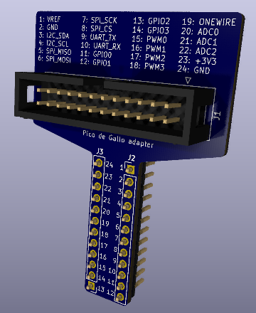

# Adapters

## Breadboard adapter

The `breadboard_adapter` subfolder contains the KiCad schematic
for a breadboard adapter.
This adpaters allows connecting all pins of the Pico de Gallo
to a breadboard with a single ribbon cable.

All pins are labeled according to the Pico de Gallo hardware rev 1.1.
Pin 1 on the ribbon cable connector is indicated on the PCB,
all individual breadboard pins are labeled.

**Required components**:

- 2 x 0.1"/2.54mm pitched single row headers, 12 positions each
- 1 x ribbon cable connector (same type as for Pico de Gallo)
